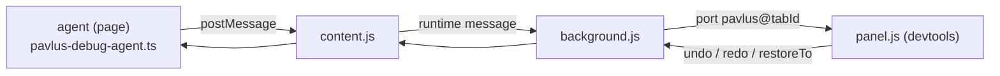

# Pavlus debug panel

A Chrome extension that shows what a running
[pavlus](../framework) app is doing: every message, every effect (with how
long each plugin took), and the store with its history — which you can step
back and forward through.

    ┌ DevTools ───────────────────────────────────────────────────┐
    │ Elements  Console  …  Pavlus                                │
    │ ─────────────────────────────────────────────────────────── │
    │ ● admin-app — 14 messages          Messages Effects Store   │
    │ …                                                           │

## Load it (unpacked)

1. `chrome://extensions` → enable **Developer mode**.
2. **Load unpacked** → select `debug-panel/extension/`.
3. Open the page with a pavlus app, then DevTools → the **Pavlus** tab.

No build step, no permissions: the extension is four small files
(`manifest.json`, `content.js`, `background.js`, `panel.*`).

### Firefox

Firefox has no extension service workers, so it gets its own manifest (MV2
with a persistent background page — which also means the background never
suspends). The other files are identical to Chrome's; keep them in sync with
`npm run debug:sync-firefox` after editing.

1. Open `about:debugging#/runtime/this-firefox`.
2. **Load Temporary Add-on…** → pick `debug-panel/extension-firefox/manifest.json`.
3. Open the page with a pavlus app, then DevTools → the **Pavlus** tab.

A temporary add-on is removed when Firefox exits — load it again in the next
session.

## Wire an app in

Add the in-page agent next to your app (client entry only — the module
assumes a `window`-like host):

```ts
import { createPavlusDebug } from "../debug-panel/agent/pavlus-debug-agent.ts";

const debug = createPavlusDebug({ name: "admin-app", app: shell });
const dom = createDomPlugin();
// …one instance per plugin…
const plugins = [store, dom, http, router, debug.plugin];
debug.watch(plugins); // before createApp: measures each plugin's handle
const app = createApp({
  app: shell,
  plugins,
  onStep: debug.onStep,
  mount: "#app",
});
```

- `debug.plugin` — a `debug` plugin that observes state changes (put it
  last).
- `app: shell` — the root component instance. The agent walks its
  `children` / `routing` so the Apps tab can draw the component tree
  (`users`, `users.editor`, …). Without it the tree shows apps only. A
  component can carry a display **tag** — `tag: "user-form"` on the child
  spec, or a `tag = "user-form"` field on a `Component` subclass — shown as
  the node's label in the tree and in the Apps pane. The agent also records
  each component's observed **input/output**: which messages reached it and
  which effects its subtree produced (see the Apps tab's **io** view).
- `debug.watch(plugins)` — wraps each plugin's `handle` to measure how long
  every effect took (`dur`), and finds the store plugin for the timeline.
  Must get the **same instances** the app uses.
- `debug.onStep` — records each message with its effects. Without it there
  are no steps in the panel.
- `flushMs` — how long events batch before crossing to the panel (default
  60 ms). `flushMs: 0` streams each change as it happens — the store
  timeline updates in realtime.

`admin-app/frontend/main.ts` is wired like this and is the reference
example.

## What the panel shows

| Tab             | Content                                                                                                                                                                                                                                                                                                                                                                                                                                                                                                                                                                                                                                                                                                                                                                                                                   |
| --------------- | ------------------------------------------------------------------------------------------------------------------------------------------------------------------------------------------------------------------------------------------------------------------------------------------------------------------------------------------------------------------------------------------------------------------------------------------------------------------------------------------------------------------------------------------------------------------------------------------------------------------------------------------------------------------------------------------------------------------------------------------------------------------------------------------------------------------------- |
| **Messages**    | Every message: id, payload, effect count. Click a message to inspect it in the pane on the right — payload and each effect's raw object in the expand/collapse viewer.                                                                                                                                                                                                                                                                                                                                                                                                                                                                                                                                                                                                                                                    |
| **Effects**     | Every effect ever performed, filterable per plugin (`all` / `store` / `dom` / …). `dur` = plugin's sync handle time, `⧗` = http request → answer-message round trip. Click an effect to inspect its raw object in the pane on the right.                                                                                                                                                                                                                                                                                                                                                                                                                                                                                                                                                                                  |
| **Store**       | The state (left) and the change timeline (right), both in the expand/collapse viewer. The **stepper** (circles left of the buttons) is one circle per change — click to jump; dashed = redoable. **⟵ back** = undo, **forward ⟶** = redo. Click a change to travel to it (undo/redo) — no change is ever removed; undone ones stay as dashed rows. Hover a change to preview its value in the pane below; hover the preview to light its row in the list. The preview pane always shows a change (the current one until you hover another to pin it); drag the dividers to resize the panes.                                                                                                                                                                                                                              |
| **Time travel** | All store changes as a vertical rail: a circle per change on a line — blue = current, filled = applied, dashed = redoable. Click a circle to travel to that state and inspect the change (its value in the expand/collapse viewer) in the pane on the right. **⟵ back** / **forward ⟶** and the **←/→** keys (they work on Store and Time travel) step one change at a time. Drag the divider to resize.                                                                                                                                                                                                                                                                                                                                                                                                                  |
| **Apps**        | The page's apps and their components (`children` / `routing`, via `app` in `createPavlusDebug`) as an SVG tree, one node per component (label = its display `tag`, tooltip = its dotted message prefix). Click a component to filter the data views to it and inspect it in the pane on the right; click an app for the whole app, **all apps** clears. The pane has five views: **info** (plugins, component + tag, counts, state in the viewer), **io** (the selected component's observed input — messages received, with counts — and output — effects produced, with summaries; with no component selected it aggregates the whole app), **messages**, **effects** and **timeline** — filtered to the selection; clicking a message or effect opens it in its tab, clicking a timeline change travels to that state. |

Every two-pane tab (Messages, Effects, Store, Time travel, Apps) has draggable dividers: drag
the vertical one to resize the left/right split, and on Store also the
horizontal one under the timeline to resize the preview pane.

The toolbar dot: grey = no agent yet, amber = waiting for a reply, green =
connected. **rescan** re-asks the page for agents (use after wiring an app
in without reloading the devtools).

## Troubleshooting

**No messages / the dot stays amber.** Work through this list — each step
is a real gotcha:

1. **Reload the page** (Cmd/Ctrl+R). Content scripts are only injected
   when a page loads: a tab that was open before you loaded the extension
   has no `content.js`, so the agent never hears the panel.
2. **Reload the extension** after changing its files: `chrome://extensions`
   → Pavlus card → the circular-arrow icon, then reload the page again.
3. **Close and reopen DevTools** after updating `panel.*`/`devtools.*` —
   the panel is only evaluated when DevTools opens.
4. Check the agent is alive: in the **page's** console, `__pavlusDebug`
   should be `[{ id: "admin-app", events: […] }]` with `events.length > 0`.
   - undefined → the app never wired the agent (check the browser console
     for module errors, e.g. a blocked `/@fs/...` request).
   - has events but the panel is empty → the relay is broken: reload the
     extension and the page (steps 1–3).
5. If the panel says "panel disconnected — reconnecting…", the background
   worker was suspended (idle ~30s). It reconnects by itself; press
   **rescan** if it doesn't.
6. You navigated and the Store tab flashed "no pavlus agent on this page
   yet". A document load (typed URL, hard reload) starts a fresh agent, so
   the panel now polls for its hello every 500 ms and shows an amber
   "page changed — waiting for the pavlus agent…" with the previous
   recording kept on screen until the new page replaces it. Plain
   client-side route changes (pushState links) never reload the document
   and don't affect the panel at all.

## How the pieces talk



- The agent records steps, states and the store history, and posts them to
  the page (`{ source: "__pavlus_agent__", batch | hello }`), where the
  content script relays them into the extension.
- Time travel is not a panel-side trick: the panel's `undo` / `redo` /
  `restoreTo` reach the agent, which applies them with
  `ctx.dispatchEffect` — through the real core, so every plugin (DOM!)
  re-renders, exactly like an app-produced change.
- The panel can be opened at any time: a `hello` gets apps, state, history
  and a replay of the last 1500 recorded events (3000 are kept).
- Several apps can live on one page; each gets its own agent id
  (`name`, `name#1`, …), and the commands are addressed per app.

## Limits

- Effect `wait` is only measured when the request's answer arrives as the
  message named by `onSuccess` / `onError` (the normal http plugin flow).
- State snapshots and payloads travel as JSON (structured clone): keep them
  serializable; states over ~300 kB are shown as "too big to display".
- Panel time-travel buttons are enabled from the panel's own bookkeeping
  (`future` counter); the store caps history at 1000 entries
  (`createStorePlugin`'s `maxHistory`), so `restoreTo` cannot reach past it.
- The extension injects into every page (`<all_urls>`), but pages without a
  pavlus agent stay silent; `chrome://` pages relay nothing.
