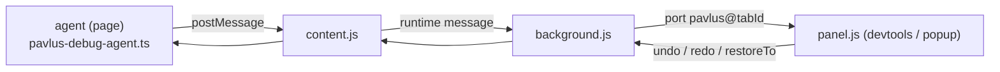

# Pavlus debug panel

A Chrome extension that shows what a running
[pavlus](../framework) app is doing: every message, every effect (with how
long each plugin took), and the store with its history — which you can step
back and forward through.

    ┌ DevTools ───────────────────────────────────────────────────┐
    │ Elements  Console  …  Pavlus                                │
    │ ─────────────────────────────────────────────────────────── │
    │ ● admin-app — 14 messages     Console Store Travel App      │
    │ …                                                           │

## Load it (unpacked)

1. `chrome://extensions` → enable **Developer mode**.
2. **Load unpacked** → select `debug-panel/extension/`.
3. Open the page with a pavlus app, then DevTools → the **Pavlus** tab.

No build step, no extra permissions: the extension is four small files
(`manifest.json`, `content.js`, `background.js`, `panel.*`).

### Open without DevTools

**Cmd+Shift+V** (Ctrl+Shift+V on Windows/Linux) opens the panel in its own
window for the active tab — no DevTools needed. The manifest declares
`Ctrl+Shift+V`, which Chrome reads as ⌘ on macOS. Press it again to focus the
window if it's already open; close it like any window. The standalone panel
is the same page as the devtools tab and gets the same live stream (page
reloads are picked up too).

The shortcut is Chrome-only (the Firefox manifest declares no commands) and
can be remapped on `chrome://extensions/shortcuts`. Note it shadows the
browser's "paste without formatting" — remap it there if you use that.

### Firefox

Firefox has no extension service workers, so it gets its own manifest (MV2
with a persistent background page — which also means the background never
suspends). The other files are identical to Chrome's; keep them in sync with
`npm run debug:sync-firefox` after editing.

1. Open `about:debugging#/runtime/this-firefox`.
2. **Load Temporary Add-on…** → pick `debug-panel/extension-firefox/manifest.json`.
3. Open the page with a pavlus app, then DevTools → the **Pavlus** tab.

A temporary add-on is removed when Firefox exits — load it again in the next
session.

## Wire an app in

Add the in-page agent next to your app (client entry only — the module
assumes a `window`-like host):

```ts
import { createPavlusDebug } from "../debug-panel/agent/pavlus-debug-agent.ts";

const debug = createPavlusDebug({ name: "admin-app", app: shell });
const dom = new DomPlugin();
// …one instance per plugin…
const plugins = [store, dom, http, router, debug.plugin];
debug.watch(plugins); // before createApp: measures each plugin's handle
const app = createApp({
  app: shell,
  plugins,
  onStep: debug.onStep,
  mount: "#app",
});
```

- `debug.plugin` — a `debug` plugin that observes state changes (put it
  last).
- `app: shell` — the root component instance. The agent walks its
  `children` / `routing` so the Application tab can draw the component tree
  (`users`, `users.editor`, …). Without it the tree shows apps only. A
  component can carry a display **tag** — `tag: "user-form"` on the child
  spec, or a `tag = "user-form"` field on a `Component` subclass — shown as
  the node's label in the tree and in the Application pane. The agent also records
  each component's observed **input/output**: which messages reached it and
  which effects its subtree produced (see the Application tab's **io** view).
- `debug.watch(plugins)` — wraps each plugin's `handle` to measure how long
  every effect took (`dur`), and finds the store plugin for the timeline.
  Must get the **same instances** the app uses.
- `debug.onStep` — records each message with its effects. Without it there
  are no steps in the panel.
- `flushMs` — how long events batch before crossing to the panel (default
  60 ms). `flushMs: 0` streams each change as it happens — the store
  timeline updates in realtime.

`applications/admin/frontend/main.ts` is wired like this and is the reference
example.

## What the panel shows

| Tab             | Content                                                                                                                                                                                                                                                                                                                                                                                                                                                                                                                                                                                                                                                                                                                                                                                                                                                                                                                                                                                                                                                                                                                                                                                                                                                                                                                                                                                                                                                                                                                                                                                                                                                                                                                                                                                                                                                                                                                                                                                                                                                                                                                                                                                                                  |
| --------------- | ------------------------------------------------------------------------------------------------------------------------------------------------------------------------------------------------------------------------------------------------------------------------------------------------------------------------------------------------------------------------------------------------------------------------------------------------------------------------------------------------------------------------------------------------------------------------------------------------------------------------------------------------------------------------------------------------------------------------------------------------------------------------------------------------------------------------------------------------------------------------------------------------------------------------------------------------------------------------------------------------------------------------------------------------------------------------------------------------------------------------------------------------------------------------------------------------------------------------------------------------------------------------------------------------------------------------------------------------------------------------------------------------------------------------------------------------------------------------------------------------------------------------------------------------------------------------------------------------------------------------------------------------------------------------------------------------------------------------------------------------------------------------------------------------------------------------------------------------------------------------------------------------------------------------------------------------------------------------------------------------------------------------------------------------------------------------------------------------------------------------------------------------------------------------------------------------------------------------ |
| **Console**     | Messages and effects as one chronological stream — a message row (`»`) followed by its effects (indented; the time column stays flush left). The leftmost toolbar icon toggles a **component sidebar** (like Chrome's console filter sidebar): the app's component tree — clicking a component narrows the stream to its messages and effects, itself and everything under it (the selection is shared with the Application tab and shows as a removable chip in the toolbar; the divider resizes it). The other chips come in two segmented groups — **show** (`all` / `messages` / `effects`) and **plugins** (an effect's plugin or a message's sender; `page` = dispatched from the page) — then the **Filter** box for text. The 🚫 button clears the recording; the crossed-funnel button resets every filter at once (show, plugins, the search box, the component sidebar selection — dim when all is already default). Click a row to inspect it in the pane on the right (payload + effects, or the raw effect object, in the expand/collapse viewer). Sticks to the bottom while the app runs, unless scrolled up.                                                                                                                                                                                                                                                                                                                                                                                                                                                                                                                                                                                                                                                                                                                                                                                                                                                                                                                                                                                                                                                                                            |     |
| **Store**       | The state (left) and the change timeline (right), both in the expand/collapse viewer. The toolbar's leftmost icon toggles a **component sidebar** (the Console's one): clicking a component narrows the state pane to its **state slice** (`state[key chain]`; a keyless chain sees its parent's slice or the whole app state — noted under the header) and the timeline — stepper dots and rows — to the changes under that key (the header shows `n of total`; the removable chip clears the selection; the divider resizes it). The **stepper** (circles left of the buttons) is one circle per change — click to jump; dashed = redoable. **⟵ back** = undo, **forward ⟶** = redo. Click a change to travel to it (undo/redo) — no change is ever removed; undone ones stay as dashed rows. Hover a change to preview its value in the pane below; hover the preview to light its row in the list. The preview pane always shows a change (the latest one under the filter until you hover another to pin it); drag the dividers to resize the panes.                                                                                                                                                                                                                                                                                                                                                                                                                                                                                                                                                                                                                                                                                                                                                                                                                                                                                                                                                                                                                                                                                                                                                                |
| **Time travel** | All store changes as a vertical rail: a circle per change on a line — blue = current, filled = applied, dashed = redoable. Click a circle to travel to that state and inspect the change (its value in the expand/collapse viewer) in the pane on the right. **⟵ back** / **forward ⟶** and the **←/→** keys (they work on Store and Time travel) step one change at a time. Drag the divider to resize.                                                                                                                                                                                                                                                                                                                                                                                                                                                                                                                                                                                                                                                                                                                                                                                                                                                                                                                                                                                                                                                                                                                                                                                                                                                                                                                                                                                                                                                                                                                                                                                                                                                                                                                                                                                                                 |
| **Application** | The page's app as a nested, collapsible component tree (like React DevTools): one node per app (`store` / message-count badges) at the root — with a single app it is the app itself, and the panel auto-selects it — and its components from `children` / `routing` (via `app` in `createPavlusDebug`), grouped by their dotted path and labeled with their display `tag` (tooltip = the path). An `each` child (a keyed embed, one component per element of a state map) is a node of its own — named by its tag (`user-row`) — holding its rendered instances: the keys the child's `live` function returns (e.g. the page window), else every element of the map, each labeled `componentName.<key>` (`user-row.7`; the raw path `list.row.7` stays in the node's tooltip). The paths underneath (`list.row.7`) are the very paths the trace reports, so selection and the io / message filters line up, and the tree grows and shrinks with the state. A component that embeds itself, directly or through its children (a tree view, a nested comment), is a **cycle**: the walk shows one repeat deep — the repeated node carries a `↻` badge (click it to select the cycle's root, which carries one too), and every node folds on its own, so a cycle folds without folding its parent. Click a component to filter the data views to it and inspect it in the pane on the right; click an app for the whole app. The pane has five views: **info** (plugins, component + tag, counts, and the component's **state slice** in the viewer — `state[key chain]` for a keyed component; a keyless chain sees its parent's slice or the whole app state), **io** (the selected component's observed input — messages received, with counts — and output — effects produced, with summaries; both cover the whole subtree — a selected `each` group shows its instances' traffic — and with no component selected it aggregates the whole app), **messages**, **effects** and **timeline** — filtered to the selection (a component matches the messages and effects of itself and everything under it); clicking a message or effect opens it in the **Console**, clicking a timeline change travels to that state. |

Every two-pane tab (Console, Store, Time travel, Application) has draggable dividers: drag
the vertical one to resize the left/right split, and on Store also the
horizontal one under the timeline to resize the preview pane.

The toolbar dot: grey = no agent yet, amber = waiting for a reply, green =
connected. **rescan** re-asks the page for agents (use after wiring an app
in without reloading the devtools).

## Troubleshooting

**No messages / the dot stays amber.** Work through this list — each step
is a real gotcha:

1. **Reload the page** (Cmd/Ctrl+R). Content scripts are only injected
   when a page loads: a tab that was open before you loaded the extension
   has no `content.js`, so the agent never hears the panel.
2. **Reload the extension** after changing its files: `chrome://extensions`
   → Pavlus card → the circular-arrow icon, then reload the page again.
3. **Close and reopen DevTools** after updating `panel.*`/`devtools.*` —
   the panel is only evaluated when DevTools opens.
4. Check the agent is alive: in the **page's** console, `__pavlusDebug`
   should be `[{ id: "admin-app", events: […] }]` with `events.length > 0`.
   - undefined → the app never wired the agent (check the browser console
     for module errors, e.g. a blocked `/@fs/...` request).
   - has events but the panel is empty → the relay is broken: reload the
     extension and the page (steps 1–3).
5. If the panel says "panel disconnected — reconnecting…", the background
   worker was suspended (idle ~30s). It reconnects by itself; press
   **rescan** if it doesn't.
6. You navigated and the Store tab flashed "no pavlus agent on this page
   yet". A document load (typed URL, hard reload) starts a fresh agent, so
   the panel now polls for its hello every 500 ms and shows an amber
   "page changed — waiting for the pavlus agent…" with the previous
   recording kept on screen until the new page replaces it. Plain
   client-side route changes (pushState links) never reload the document
   and don't affect the panel at all.

## How the pieces talk



- The agent records steps, states and the store history, and posts them to
  the page (`{ source: "__pavlus_agent__", batch | hello }`), where the
  content script relays them into the extension.
- A tab can host several panels at once (the devtools tab + standalone
  windows): the background worker keeps a port per panel and mirrors every
  agent event to all of them.
- Time travel is not a panel-side trick: the panel's `undo` / `redo` /
  `restoreTo` reach the agent, which applies them with
  `ctx.dispatchEffect` — through the real core, so every plugin (DOM!)
  re-renders, exactly like an app-produced change.
- The panel can be opened at any time: a `hello` gets apps, state, history
  and a replay of the last 1500 recorded events (3000 are kept).
- Several apps can live on one page; each gets its own agent id
  (`name`, `name#1`, …), and the commands are addressed per app.

## Limits

- Effect `wait` is only measured when the request's answer arrives as the
  message named by `onSuccess` / `onError` (the normal http plugin flow).
- State snapshots and payloads travel as JSON (structured clone): keep them
  serializable; states over ~300 kB are shown as "too big to display".
- Panel time-travel buttons are enabled from the panel's own bookkeeping
  (`future` counter); the store caps history at 1000 entries
  (`createStorePlugin`'s `maxHistory`), so `restoreTo` cannot reach past it.
- The extension injects into every page (`<all_urls>`), but pages without a
  pavlus agent stay silent; `chrome://` pages relay nothing.
