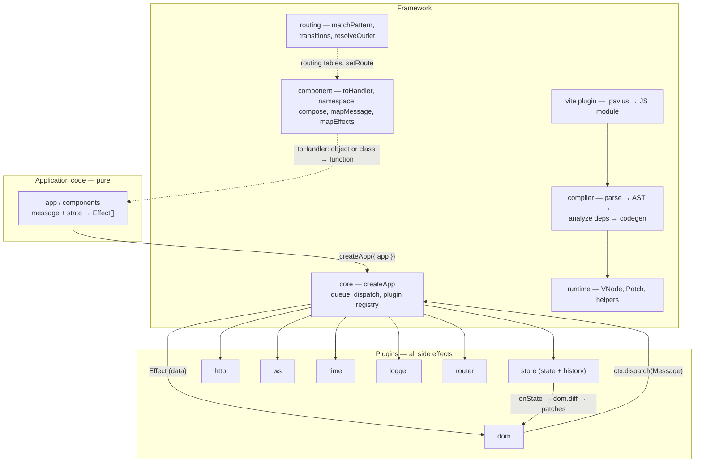
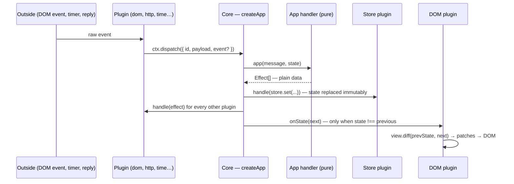
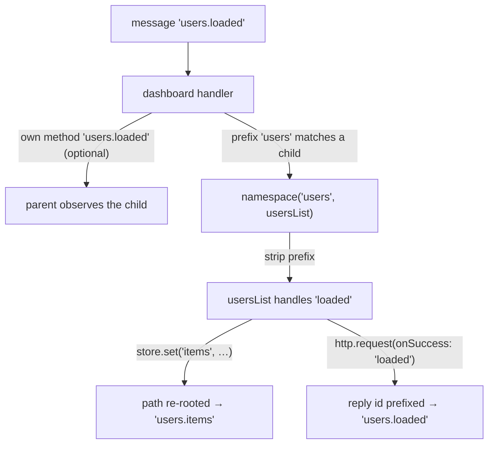
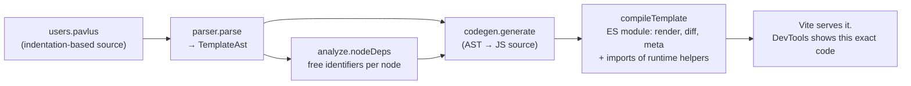

# Architecture

How pavlus works, in the order the code reads. Diagrams are
[Mermaid](https://mermaid.js.org) (GitHub renders them). Other docs:
[plugins](./plugins/main.md), [routing](./routing.md),
[child views](./child-views.md).

## 1. The big picture

Pavlus is an Elm-style architecture with a compiler attached:

- **Application code is pure.** A handler receives a message and the state and
  returns effects. It may not touch the DOM, the network, the clock or
  randomness.
- **Effects are plain data.** `{ plugin, type, ... }` objects describe *what*
  should happen; plugins decide *how*.
- **Plugins own every side effect.** DOM, HTTP, websockets, timers, logging and
  routing are separate, swappable plugins.
- **Templates compile to pure functions.** A `.pavlus` file becomes a module
  exporting `render(state)` and `diff(prev, next)`. The DOM plugin is the only
  code that turns the resulting vnodes and patches into real DOM.

```
DOM event / HTTP reply / timer / WS frame
        │  plugins turn the outside world into messages
        ▼
  core:  app(message, state) → effects[]      ← pure, deterministic
        │  effects are plain data
        ▼
  plugins: dom · store · http · ws · time · logger · router · yours
```



### Reading map (suggested order for a newcomer)

| # | File | What you learn |
|---|---|---|
| 1 | `main.ts` | The public API surface (one screen). |
| 2 | `src/core/types.ts` | The whole contract: `Message`, `Effect`, `Plugin`, `PluginContext`. |
| 3 | `src/core/mod.ts` | The runtime loop: ~110 lines, no dependencies beyond types. |
| 4 | `src/component/mod.ts` | How objects and classes become handlers; children and namespacing. |
| 5 | `src/runtime/vnode.ts` | What templates produce: `VNode`, `Patch`, `View`. |
| 6 | `src/plugins/dom/mod.ts` | How vnodes and patches become DOM; how events become messages. |
| 7 | `src/plugins/store/mod.ts` | Immutable updates and undo history. |
| 8 | `src/template/parser.ts`, `src/template/ast.ts` | Template source → AST. |
| 9 | `src/compiler/analyze.ts` | The dependency trick that makes `diff` cheap. |
| 10 | `src/compiler/codegen.ts`, `src/compiler/emit/` | AST → readable `render`/`diff` source. Read `emit/` bottom-up: `base` → `expr` → `render` → `diff`. |
| 11 | `../admin-app/` | Everything assembled in a real app. |

## 2. One tick of the app (`src/core/mod.ts`)

`createApp({ app, plugins, init, ... })` wires a pure handler to plugins.

1. Plugins are registered in a `Map` by name; duplicates throw. The first plugin
   with a `getState()` (the store) becomes the state source.
2. `dispatch(message)` pushes onto a queue. If a tick is already running, the
   message is processed in the same tick (re-entrancy is collapsed).
3. Per message: `effects = app(msg, state)`, then `onStep?.`, then each effect is
   handed to the plugin named `effect.plugin` (`plugin.handle(effect, ctx)`, in
   the order the effects were returned).
4. Then `getState()` is read again; **only if the state object identity changed**
   (`next !== state`) every plugin gets `onState(next, ctx)`. This is what makes
   the DOM plugin re-render, and why state must be treated as immutable.
5. A safety valve throws if more than `maxMessagesPerTick` (default 10 000)
   messages are processed in one tick (message loops).
6. `dispose()` disposes plugins in reverse registration order.



**The plugin contract** (`src/core/types.ts`):

| Member | Required | Purpose |
|---|---|---|
| `name` | yes | Matches `effect.plugin`. |
| `init?(ctx)` | no | Grab `dispatch`/`getState`, start listeners. |
| `handle(effect, ctx)` | yes | Do the dirty work for one effect. |
| `onState?(state, ctx)` | no | React to state changes (the DOM plugin re-renders). |
| `dispose?()` | no | Remove listeners, abort requests, close sockets. |
| `getState?()` | no | Marks a stateful plugin (the store). |

Application code rarely writes raw effect objects: each plugin exports an
**effector**, a typed builder (`store.set("user.name", v)`,
`http.request({...})`, `log.info(...)`; see `src/plugins/*/helpers.ts` and
[plugins/main.md](./plugins/main.md)).

## 3. Components and the message tree (`src/component/mod.ts`)

A component is **a function, or an instance of a class that extends
`Component`** (`src/component/mod.ts`). Each method of the class is the handler
of the message with that name; `view`, `children`, `routing`, `dispatch` and
`_`-prefixed names are never handlers. `toHandler()` normalizes both forms to
`(message, state) => Effect[]` (an instance's handler is cached in a `WeakMap`);
a plain object or a class that does not extend `Component` is refused.

`Component#dispatch(message, state)` is where a message goes:

1. The component's **own** handler for `msg.id` runs first, so a parent can
   observe `users.loaded` addressed to its child.
2. If the id starts with `<childName>.`, the remainder is forwarded to that child.

`namespace(prefix, child, { key, props })` is the primitive behind `children`:

- inbound: only messages `"<prefix>.x"` pass, and the child sees `"x"`;
- outbound: reply ids in the child's effects (`onSuccess`, `replyTo`, …) get the
  prefix back, and `store` effects with a `path` are re-rooted under `key`;
- state: the child sees `state[key]` plus read-only `props(state)`.



Combinators work on any form: `compose` (run several components on the same
message), `mapMessage` / `mapEffects` (wrap in/out), `withLogging`, `namespace`.

**Children** are declared once in
`children: { users: { component | select, key, props } }`. The instance name in
the template (`+Child#users`), the `children` key, and the state slice
`state.users` are the same string.

## 4. Routing (`src/routing/mod.ts` and the routing glue in `src/component/mod.ts`)

See [routing.md](./routing.md) for the full reference. In short:

- The **router plugin** reports the location as a message payload; the owning
  component stores it at `state.route` (`ctx.setRoute(...)`).
- A `routing` table maps path patterns (`"/"`, `"/users/:id"`, `"*"`) to child
  specs. The longest pattern wins; `"*"` only when nothing else matches.
- `chain()` walks routed children top-down (each child's state carries its own
  `route`); `transitions()` computes `leave`/`enter` messages for the subtree
  that changed, deepest first out and top-down in. A child whose route changed
  but stayed active re-enters.
- `navigate` effects emitted inside a routed child are rewritten to be
  **relative to the child's base** (`routedHandler`).
- `+outlet` in a template is resolved at render time by
  `resolveOutlet(env, state)`: `env` is the component that owns the view (passed
  down through `render`) and must have a `routing` table.

## 5. Templates: from `.pavlus` to `render`/`diff`



- **Parser** (`template/parser.ts`): line-based and indentation-based (pug/slim
  style). Tabs are rejected, `//` comments stripped (only after whitespace, so
  `http://` survives), `import X from "…"` allowed only at the top. Node kinds:
  element, text (`| …`, inline, `{expr}`), `if/else if/else`, `for … in … [key …]`,
  embed (`+Name#users(...)` static, `+{expr}#users(...)` dynamic), `+outlet`.
- **Expressions** (`template/expr.ts`): a small pure JS subset (null-safe paths,
  literals, operators, ternary, calls, arrays) parsed by a recursive-descent
  `ExprParser` with precedence climbing.
- **Analysis** (`compiler/analyze.ts`): `nodeDeps(node)` collects the root
  identifiers a subtree reads (state roots and loop variables; `""` means
  "depends on everything", used by outlets). Memoized per node in a `WeakMap`
  keyed by node identity. This is what lets `diff` skip unchanged subtrees.
- **Codegen** (`compiler/codegen.ts` and `compiler/emit/`): a `Writer` collects
  indented lines. The emitters are **layers of one object**, each adding one
  concern on top of the one below, so all of them share a single writer, name
  scope and helper set:

  ```
  EmitBase      names, scopes, helpers, capture()          emit/base.ts
    └ ExprEmitter    expressions per side, attributes, props   emit/expr.ts
        └ RenderEmitter  the body of render()                    emit/render.ts
            └ DiffEmitter    the body of diff() (renders new      emit/diff.ts
                             content with the layer below)
  ```

  `codegen.ts` wires the top layer into the module (`meta`, `render`, `diff`).
  Diff sits above render because it has to produce new nodes (an inserted list
  item, a new branch) with the render emitters. Two details matter:
  - *Names*: a scope stack makes generated variables readable (`userList`,
    `prevUserKeys`, `liChildren`) and unique only where JS scopes genuinely
    overlap.
  - *Two sides*: every expression is emitted twice, once against `prev` and once
    against `next` (`expr(e, ctx, side)`); comparisons between the two become
    guards.
- **Output module**: header comment, `import { … } from "<runtime>"` (only helpers
  actually used), imports of child views, then `meta`, `render`, `diff`,
  `export { render, diff, meta }` and a default export. Deliberately **no source
  map**: you debug the generated code, which is written to be readable. The
  golden files in `src/compiler/__goldens__/` pin it byte for byte (the
  templates are in `src/compiler/__fixtures__/`; run `vitest -u` after an
  intentional change).
- **Vite plugin** (`vite/mod.ts`): `enforce: "pre"`, transforms `*.pavlus`,
  returns `map: { mappings: "" }` so Vite invents nothing.

The real output for

```
ul.list
  for user in users key user.id
    li.item(class:on=user.on @click=pick(user.id)) {user.name}
```

is (abridged: header, `import`, and the bodies of `remove`/`insert`/`move` are
left out; everything else is verbatim)

```js
const meta = { embeds: [], outlet: false };

function render(state, idSuffix = "", messagePrefix = "", env) {
  const nodes = [];
  // line 1: <ul.list>
  const ulChildren = [];
  // line 2: for user
  ulChildren.push({ t: "marker", id: "1s" + idSuffix });
  const userList = (state.users) || [];
  for (let userIndex = 0; userIndex < userList.length; userIndex++) {
    const user = userList[userIndex];
    const userKey = String((user)?.id);
    const userSuffix = idSuffix + "#" + userKey;
    ulChildren.push({ t: "marker", id: "1[" + userSuffix });
    // line 3: <li.item>
    const liChildren = [];
    liChildren.push({ t: "text", id: "3" + userSuffix, text: "" + toText((user)?.name) });
    const liAttrs = {};
    setAttr(liAttrs, "class", joinClasses(["item", ((user)?.on ? "on" : "")]));
    const liEvents = {
      "click": { id: messagePrefix + "pick", payload: (user)?.id },
    };
    ulChildren.push({ t: "el", id: "2" + userSuffix, tag: "li",
      attrs: liAttrs, events: liEvents, children: liChildren });
    ulChildren.push({ t: "marker", id: "1]" + userSuffix });
  }
  ulChildren.push({ t: "marker", id: "1e" + idSuffix });
  // ... nodes.push the <ul>
  return nodes;
}

function diff(prev, next, idSuffix = "", messagePrefix = "", env) {
  const patches = [];
  if (prev === next) return patches;
  // line 1: <ul.list> (reads: users)
  if (prev.users !== next.users) {
    // line 2: for user
    const prevUserList = (prev.users) || [];
    const nextUserList = (next.users) || [];
    const prevUserKeys = prevUserList.map((user, userIndex) => String((user)?.id));
    const nextUserKeys = nextUserList.map((user, userIndex) => String((user)?.id));
    const userStartId = (key) => "1[" + idSuffix + "#" + key;
    const userEndId = (key) => "1]" + idSuffix + "#" + key;
    diffKeyedList(prevUserKeys, nextUserKeys, userStartId, "1e" + idSuffix, {
      remove(key) { /* patch: remove the item's range */ },
      insert(index, beforeId) { /* render the new item from `next`, patch: insert */ },
      move(key, beforeId) { /* patch: move the item's range */ },
      common(prevIndex, nextIndex) {
        const prevUser = prevUserList[prevIndex];
        const nextUser = nextUserList[nextIndex];
        // line 3: <li.item> (reads: user)
        if (prevUser !== nextUser) {
          const prevClass = joinClasses(["item", ((prevUser)?.on ? "on" : "")]);
          const nextClass = joinClasses(["item", ((nextUser)?.on ? "on" : "")]);
          if (prevClass !== nextClass) { /* patch: attr class (or rmAttr) */ }
          // payload `user.id`: patch "handler" only if it changed
          // text `user.name`:  patch "text" only if it changed
        }
      },
    });
  }
  return patches;
}
```

What `diff` gets away with:

- **Subtree skip:** a node whose dependency set is unchanged (`prev.x !== next.x`
  per root identifier) emits nothing at all.
- **Keyed lists:** `diffKeyedList` (runtime) reconciles by key: remove, then
  insert/move walking from the end, then `common` for surviving items.
- **`if` blocks:** the branch index is computed per side; a flip clears between
  the markers and renders the new branch from `next` only; the same branch diffs
  inside.
- **Embeds and outlets:** the child view is replaced (never cross-diffed) when the
  view or component itself changes; otherwise `childView.diff(propsPrev,
  propsNext, …)`.
- **Handlers are data**, so `diff` compares payloads by value and re-binds
  listeners only when they changed.

## 6. The DOM plugin (`src/plugins/dom/mod.ts`)

- One **instance** per mounted container: start/end comment markers, the view,
  the component (`env`) if one was mounted, the last rendered state, and
  `nodes: Map<id, Node>`.
- `build(vnode)` creates nodes and registers ids; `apply(patches)` interprets the
  eight patch ops (`text`, `attr`, `rmAttr`, `handler`, `insert`, `clear`,
  `remove`, `move`): the only imperative DOM code in the framework.
- **Listeners:** per element and event *type* one stable listener reads the
  *latest* `EventMsg` from a map, applies `.prevent`/`.stop`, snapshots
  `{ type, value?, checked?, key? }` and dispatches the message. Listeners are
  detached recursively when nodes are disposed.
- Form controls: `value`/`checked`/`selected` are mirrored to properties, not just
  attributes (the attribute only seeds a field).
- `onState` diffs every instance whose stored state identity differs, then patches.

## 7. The store plugin (`src/plugins/store/mod.ts`)

- Effects: `set`, `merge`, `remove`, `undo`, `restoreTo`, all addressed by a
  `Path` (`"user.email"` or `["users", 3, "name"]`).
- Updates are pure functions (`setAt`, `removeAt`, `applyChange`) with structural
  sharing: untouched branches keep their object identity, which is exactly what
  `diff`'s `===` checks need. No-op writes return the same state and are not
  recorded.
- Every recorded change stores the *inverse* effect (`restoreFor`): undo and
  time travel (`restoreTo`) need no snapshots. Adding or removing an array element
  restores the whole array (indices shift).

## 8. The other plugins

| Plugin | File | State | Notes |
|---|---|---|---|
| `http` | `plugins/http/mod.ts` | `Map<id, AbortController>` | A new request with a running id aborts the old one; a cancelled request never dispatches. |
| `ws` | `plugins/ws/mod.ts` | `Map<id, SocketLike>` | `SocketLike` makes sockets fakeable in tests. String frames are `JSON.parse`d when possible. |
| `time` | `plugins/time/mod.ts` | `Map<id, cancelFn>` | The same id restarts a timer; `cancelAll` for teardown. The clock is injectable. |
| `logger` | `plugins/logger/mod.ts` | none | Writes to an injectable console-like sink. |
| `router` | `plugins/router/mod.ts` | one `stop()` closure | History API; `navigate` dispatches a synthetic `popstate` (pushState fires no event). |

## 9. Invariants to preserve

1. **Purity of app code** is a documented contract, not enforced: don't move side
   effects into the component layer.
2. **Effects and patches are plain data.** Plugins and the DOM plugin are the
   only interpreters.
3. **`diff` trusts `===`.** Store updates must keep structural sharing.
4. **Generated code stays readable**: named variables, `// line N:` comments, one
   statement per line, no minified helper names. It is a *tested feature*
   (`compiler/output.test.ts` and the goldens).
5. **`erasableSyntaxOnly`**: no enums, namespaces or constructor parameter
   properties. Classes are fine; parameter properties are not. (This is what lets
   Node run the framework source directly.)
6. **Public entry points** are pinned by `package.json` and `jsr.json` (`.`,
   `./vite`, `./compiler`, `./runtime`, `./testing`, `./plugins/*`). The internal
   file layout may change as long as `main.ts` and the `mod.ts` entry files keep
   their paths and exports. JSR's slow-types check requires explicit types on
   anything exported.
7. **Safety net:** `npm test` (Vitest, jsdom) covers core, components, plugins,
   routing, compiler output and goldens, embeds and the vite plugin.

## Glossary

| Term | Meaning | Defined in |
|---|---|---|
| **Message** | Input of the app: `{ id, payload?, event? }`. Plain data. | `core/types.ts` |
| **Effect** | Output of the app: `{ plugin, type, ... }`. A request for a plugin to do something. | `core/types.ts` |
| **Effector** | A plugin's typed builder of effects (`store.set(...)`, `http.request(...)`). | `plugins/*/helpers.ts` |
| **Plugin** | Owns side effects and its own mutable state; turns the outside world into messages. | `core/types.ts` |
| **Component** | A function, or an instance of a class extending `Component`, that maps `(message, state)` to effects; may have a `view`, `children`, `routing`. | `component/mod.ts` |
| **Handler** | A component method named after the message id it handles. | `component/mod.ts` |
| **Child / instance name** | A component under a parent; one name is its message prefix, state key and embed name. | `component/mod.ts` |
| **`namespace`** | Mounts a child under a prefix: routes messages in, re-roots reply ids and store paths out. | `component/mod.ts` |
| **View** | A compiled template: `{ render, diff, meta }`. | `runtime/vnode.ts` |
| **VNode** | What `render` returns: `el`, `text` or `marker` nodes, with ids where patched. | `runtime/vnode.ts` |
| **Patch** | What `diff` returns: one of eight DOM operations as data. | `runtime/vnode.ts` |
| **Marker** | An empty comment node delimiting an `if`, `for` or embed block. | generated code |
| **`idSuffix` / `messagePrefix`** | Passed to a child view so its node ids stay unique and its events carry the instance prefix. | generated code |
| **Embed** | `+Child#name(props)` (static) or `+{expr}#name(props)` (dynamic): a child view inside a template. | `template/parser.ts` |
| **Outlet** | `+outlet`: the routed child the component's `routing` selects for `state.route`. | `routing/mod.ts` |
| **`env`** | The component that owns a template, passed through `render`/`diff` so `+outlet` can read its `routing`. | `routing/mod.ts` |
| **Route** | `{ path, base, params, search, hash }`: where a routed child is, relative to its base. | `routing/mod.ts` |
| **`enter` / `leave`** | Messages sent to routed children when they become (in)active. | `component/mod.ts` |
